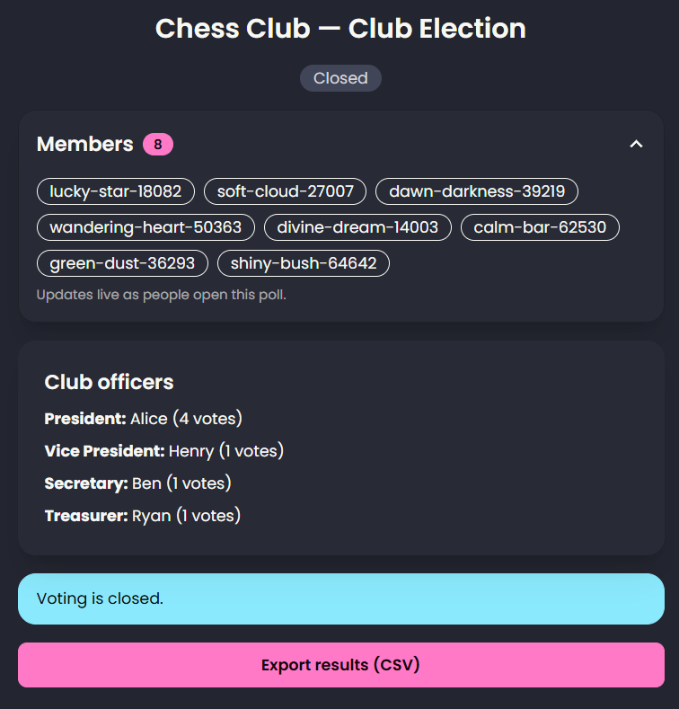
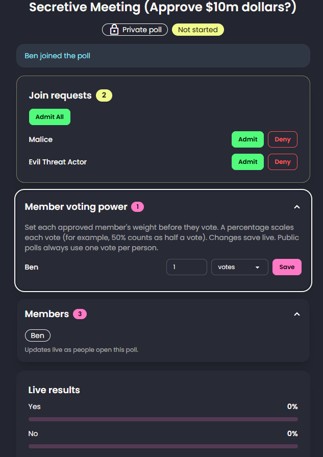
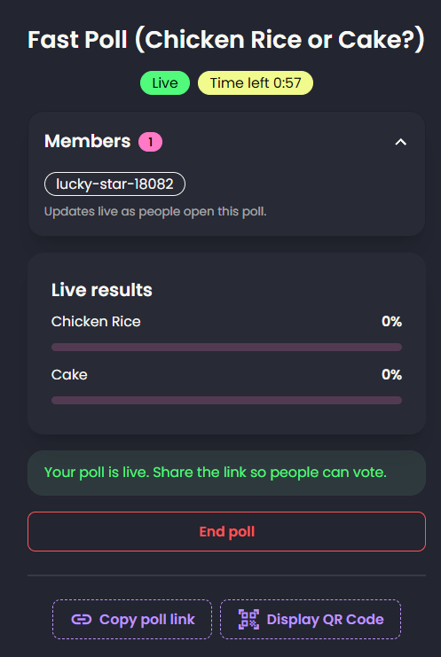
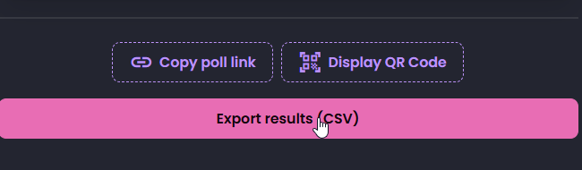
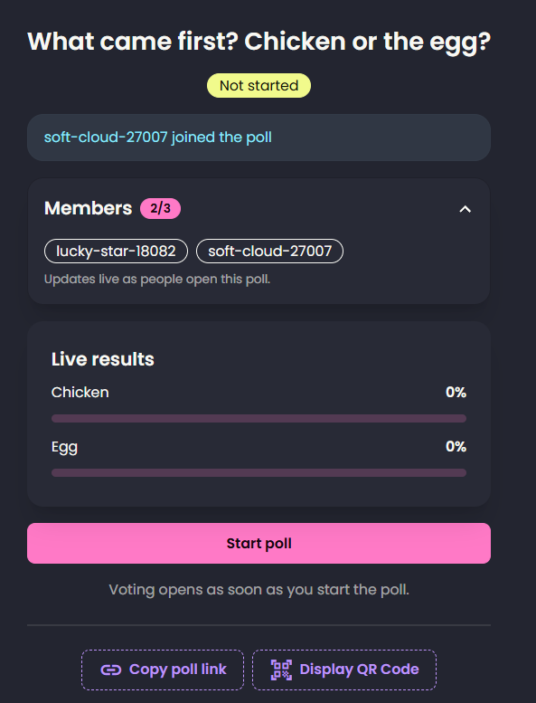

# Create A Poll Online

A minimal Flask app for creating polls with friends, making important corporate decisions, and picking club members. Fully **self-hosted, open-sourced, and no account required**.

<p align="center">
  
</p>

---


## Features

#### 1. Club Mode

> **Club Mode** is a feature to automatically know who's in charged of a club based on the amount of vote each candidate receives. The highest votes would be president, follow by the second highest for vice president, and etc.



#### 2. Display QR Code

> You don't have to type the code manually. Just display the QR code, and allow members to join.


#### 3. Private Polls

> Polls are usually public for everyone to view. However, private polls require a password and for the "host" to admit or deny users. The "host" could also set the **voting power** of each member which is important for strategic corporate meetings.



#### 4. Timed Polls

> You could set a time to conduct the polls (in minutes) before the poll ends.



#### 5. Export Results

> Since this doesn't require an account, you could export polls in a **.csv** format.



#### 6. Set Maximum Members

> You could set the **maximum members** for how many users you want to join the poll.



---

## Usage:

### Install:

1. Ensure that `python3` and `git` is installed.
2. Clone the repository:

```bash
git clone https://github.com/r4shsec/CreateAPollOnline.git
```

3. Change directories to `CreateAPollOnline/src`:

```bash
cd CreateAPollOnline/src
```

4. Rename `.env.example` to `.env`. Make sure you change `YOUR_APP_SECRET` to a strong string of text. This is **required for JWT**.

5. Rename `config.json.example` to `config.json.example`. You could edit this JSON file for any changes.

6. Create a **Python virtual environment**:

```bash
python -m venv .venv
```

7. Activate the Python Virtual Environment.

On Windows:

```bash
.\.venv\Scripts\Activate.ps1
```

On Linux:

```bash
source .venv/bin/activate
```

8. Install the **necessary requirements**:

```bash
pip install -r requirements.txt
```

```
Flask==3.1.3
bcrypt==5.0.0
PyJWT==2.15.1
gunicorn==26.2.0
haikunator===2.1.0
python-dotenv==1.2.4
Flask-SocketIO==5.7.0
simple-websocket==1.1.0
```

9. Run the app:

```bash
python app.py
```